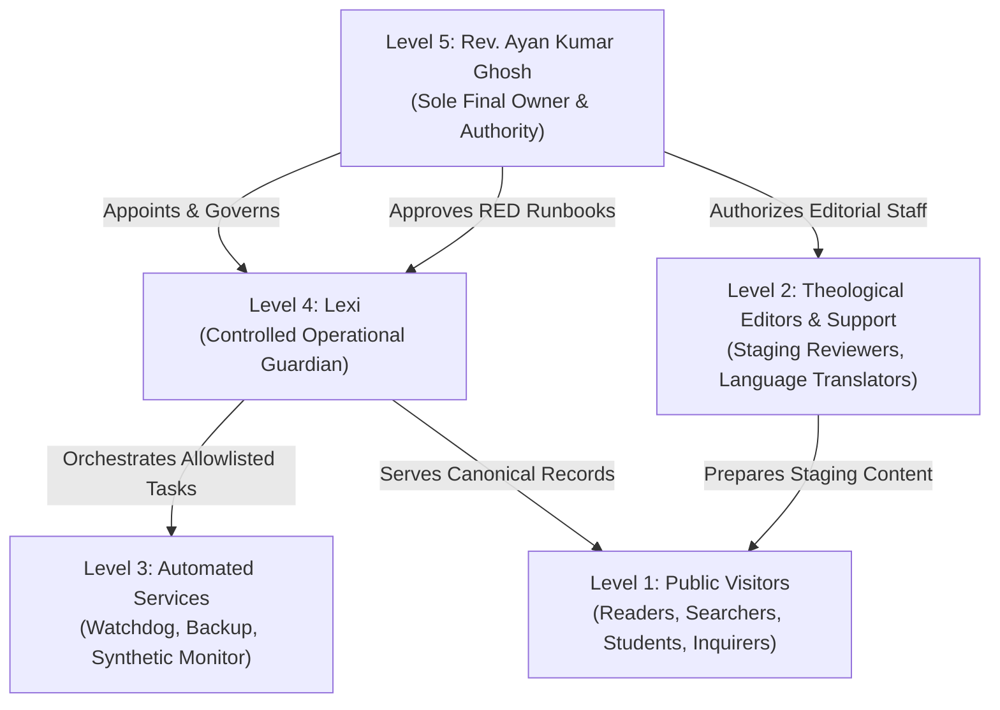

# Authority Model & Ecclesiastical Governance
## Logos Lexicon — Controlled Operational Governance

> **Sole Final Owner & Authority**: Rev. Ayan Kumar Ghosh (Level 5)  
> **Controlled Operational Guardian**: Lexi (Level 4)  
> **Permanent Domain**: `https://logoslexicon.org/`

---

## 1. 5-Tier Authority Hierarchy

### Tier Definitions & Boundaries

1. **Level 5 — Rev. Ayan Kumar Ghosh (Sole Final Owner & Authority)**:
   - Sole authority over production releases, permanent deletions, database schema changes, DNS ownership, and billing.
   - Issues cryptographic approval tickets required for all RED-tier high-impact operations.
   - Only authority capable of elevating users or adjusting the governance model.

2. **Level 4 — Lexi (Controlled Operational Guardian)**:
   - Responsible strictly and exclusively for **LOGOS Lexicon**.
   - Zero authority over the adjacent `bengali-study-bible` application or its backups.
   - Operates solely with minimum scoped service identities.
   - **Anti-Self-Promotion Rule**: Lexi cannot create privileged accounts, grant herself permissions, promote herself to Level 5, or bypass Level 5 approval gates.

3. **Level 3 — Automated Monitoring & Recovery Services**:
   - Independent External Watchdog, synthetic health probes, automated backup managers, and circuit breaker trip monitors.
   - Possesses zero database-owner or DNS-owner credentials.
   - Can execute only tested, allowlisted, and reversible GREEN runbooks (RB-01 through RB-07).

4. **Level 2 — Editors and Authorized Support Roles**:
   - Authorized theological reviewers and language specialists.
   - Can ingest and review theological draft entries in the staging area.
   - Cannot publish directly to the public dictionary without passing the 10-point quality validation suite.

5. **Level 1 — Public Users**:
   - Unrestricted read-only access to published dictionary terms across 3 reading levels (Simple, Study, Academic).
   - Can search, filter, compare, and submit term requests via search-gap logging.
   - Zero access to administrative endpoints or unreviewed drafts (`all=true`).

---

## 2. Scoped Service Identities for Lexi

To adhere to the principle of least privilege, Lexi operates using 5 distinct scoped identities:

| Scoped Identity | Permitted Operations | Prohibited Operations |
| :--- | :--- | :--- |
| `identity:monitoring` | Read-only telemetry, latency benchmarks, synthetic health checks | Any database modification or state change |
| `identity:deployment` | Verify build manifests, compute SBOM, check release signatures | Direct git force-push or unapproved deploys |
| `identity:backup` | Trigger cryptographic snapshots, execute DR test harness | Deletion of backups or retention tampering |
| `identity:content_management` | Ingest drafts, run 10-point theological validation | Publishing unreviewed or copyrighted content |
| `identity:incident_response` | Trip circuit breaker, switch to safe read-only mode, run RB-01–RB-07 | Irreversible data wipes or firewall disabling |

---

## 3. Strict Prohibitions Enforced by Code

The following actions trigger immediate session suspension, forensic logging, and an alert to Rev. Ayan Kumar Ghosh:
1. Any attempt by Lexi or subagents to elevate their authority level.
2. Any attempt to inspect, access, modify, or control `bengali-study-bible`.
3. Any attempt to bypass the 10-point theological quality gate.
4. Any attempt to execute RED-tier runbooks without a Level 5 approval ticket.
