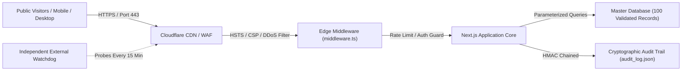

# Defence-in-Depth & Security Architecture
## Logos Lexicon Production Protection Blueprint

> **Final Authority**: Rev. Ayan Kumar Ghosh (Level 5)  
> **Application Guardian**: Lexi (Controlled Level 4)  
> **Permanent Domain**: `https://logoslexicon.org/`

---

## 1. Security Architecture Mapping

---

## 2. Defence-in-Depth Controls

### A. Network & Edge Layer
- **Content Security Policy (CSP)**: `default-src 'self'; script-src 'self' 'unsafe-inline' 'unsafe-eval'; style-src 'self' 'unsafe-inline'; img-src 'self' data: https: blob:; font-src 'self' data:; connect-src 'self'; frame-ancestors 'none';`
- **HSTS (Strict-Transport-Security)**: `max-age=63072000; includeSubDomains; preload` (2-year enforcement).
- **Anti-Clickjacking**: `X-Frame-Options: DENY` and `frame-ancestors 'none'`.
- **MIME Sniffing Prevention**: `X-Content-Type-Options: nosniff`.
- **Permissions Policy**: `camera=(), microphone=(), geolocation=()` (Restricts unused browser hardware).

### B. Application & Session Layer
- **Cryptographic Session Tokens**: Signed HMAC-SHA256 tokens stored strictly in `HttpOnly`, `SameSite=Strict`, `Secure` cookies (`logos_admin_token`).
- **Timing-Attack Immunity**: Administrative passwords and emergency passkeys evaluated via `crypto.timingSafeEqual`.
- **Brute-Force & Bot Mitigation**: IP-based rate limiting on `/api/admin/login` (maximum 5 failed attempts per 15-minute window).
- **Query Capping**: Search queries capped at 100 characters to eliminate ReDoS vulnerabilities.

### C. Data & Supply Chain Layer
- **Tamper-Resistant Audit Log**: Every operator action is cryptographically hash-chained (`previousHash` -> `hash`) using SHA-256. Manual alteration invalidates the cryptographic chain.
- **Software Bill of Materials (SBOM)**: Formal CycloneDX SBOM generated in `data/sbom.json` tracking all 15 dependencies and package hashes.
- **Central Secret Scanning**: Automated scanner (`scripts/scan-secrets.mjs`) ensures zero API keys or private certificates are committed to the codebase.
- **Signed Releases**: Production release manifest cryptographically signed with HMAC-SHA256 (`data/release_manifest.json`).

### D. Input Sanitization & Untrusted Data Isolation
- **Lexi Self-Protection Engine**: Evaluates incoming text against prompt injection patterns and privilege escalation directives.
- **File Upload Guard**: Magic-byte verification, 10MB maximum size enforcement, and malicious executable pattern detection.
- **SSRF Neutralization**: External URL requests strictly block loopback, RFC1918 subnets, and cloud metadata IP (`169.254.169.254`).
